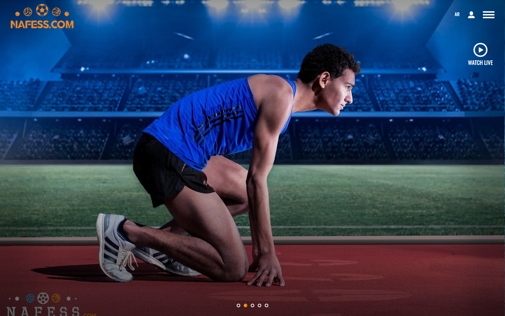
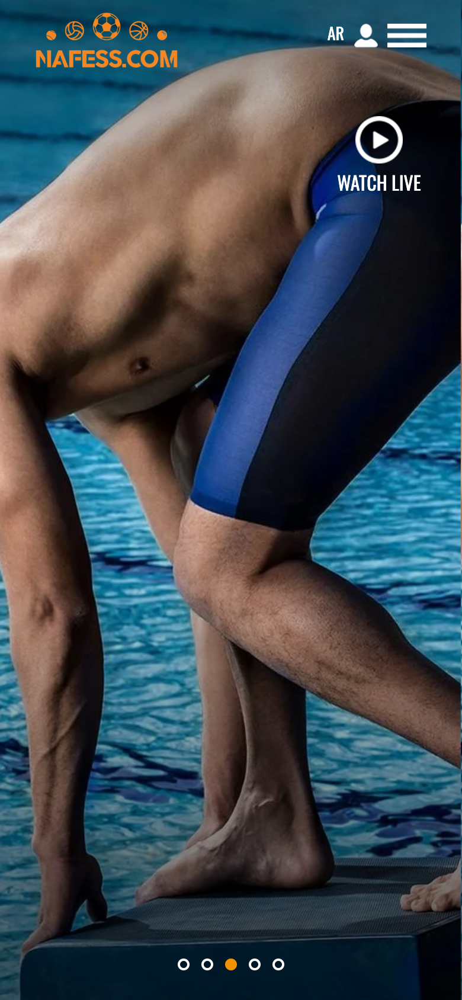
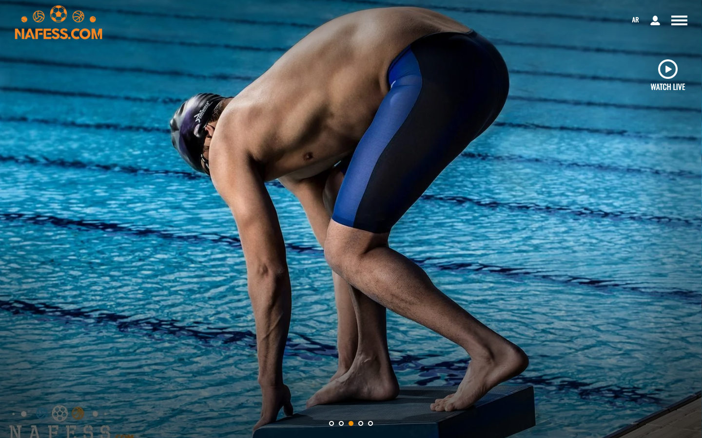
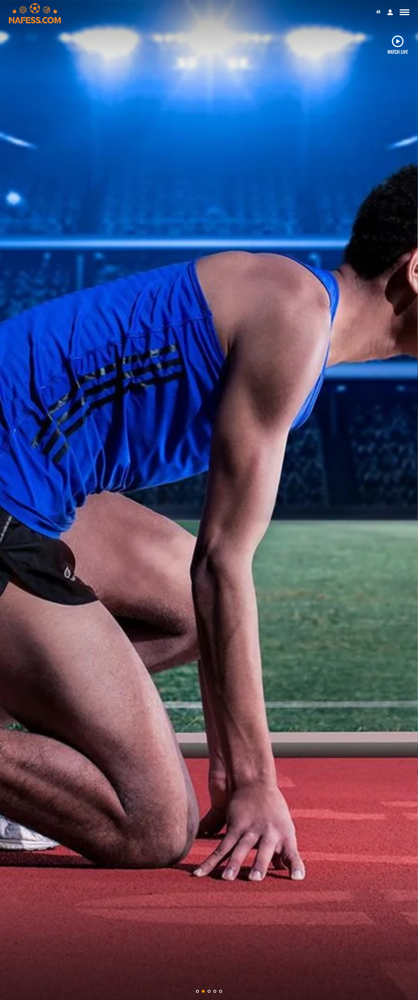

# Nafess

> Web platform built on Laravel.

**Live:** [nafess.com](https://nafess.com/) · **Role:** CTO · **Period:** 2023 – 2026 · **For:** Brand Wizard

   

## Overview

A Laravel web platform I maintained and upgraded, including moving it from a VPS to managed hosting.

## What it does

- Public website and content
- Admin panel

## Engineering highlights

- Laravel upgrade and content restoration
- Migration from VPS to Hostinger

## Screenshots (live site)

  
  

Full home page

---

Source code is private (client / commercial project). This repository documents the work only.

Built by **Ahmed Gamal** — Senior Laravel Developer · [LinkedIn](https://www.linkedin.com/in/wzcoder/) · [GitHub](https://github.com/ahmed-gamal-dev)
